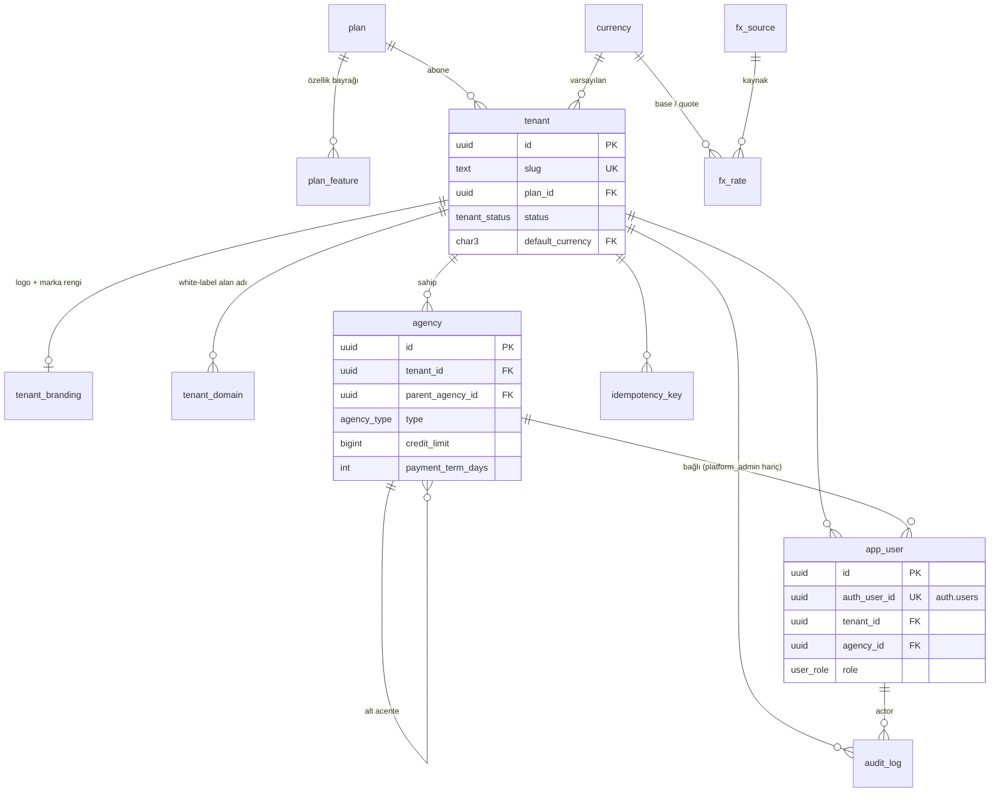
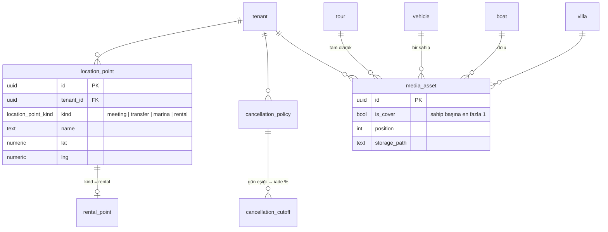
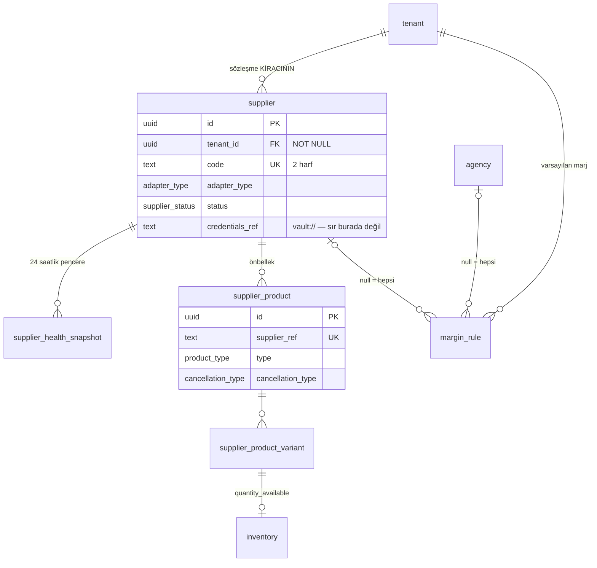
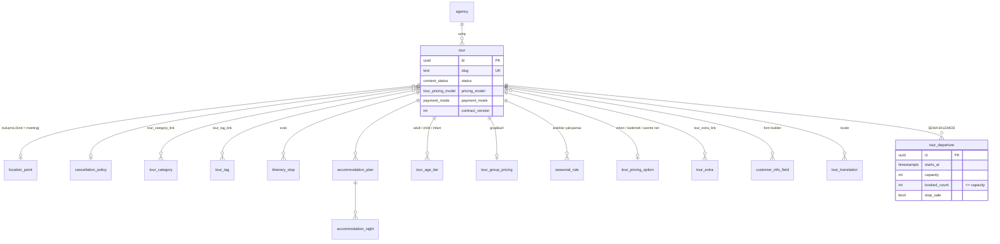
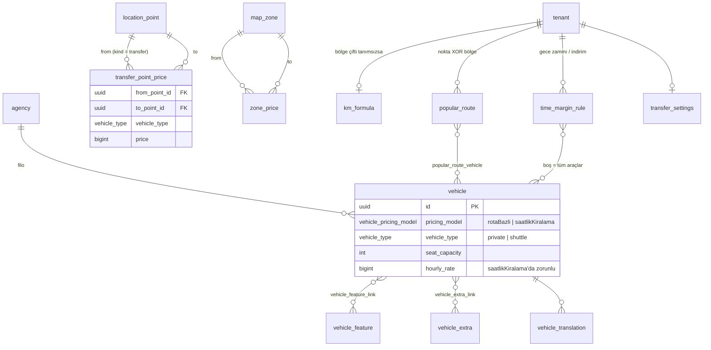
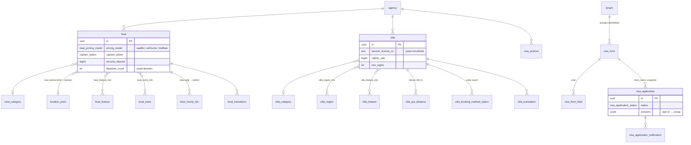
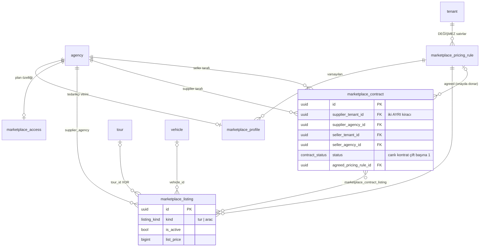
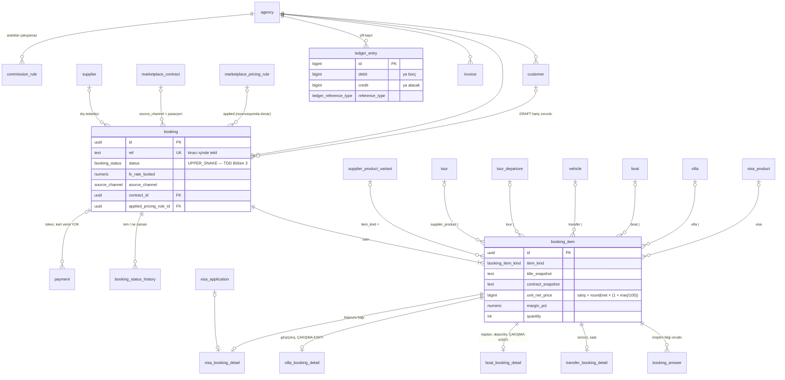

# Veri Modeli — ER Diyagramı

Supabase projesi: **b2btourism** (`kyanueyvzwzibxqqekaz`, eu-central-1, Postgres 17).
Kaynak: `supabase/migrations/` — 15 dosya, sırayla uygulanır (13 şema + 2 kimlik/RLS).

| Nesne | Sayı |
|---|---|
| Tablo | 97 |
| Görünüm | 4 (`agency_balance`, `agency_statement`, `booking_totals`, `marketplace_settlement`) |
| Enum | 54 |
| Yabancı anahtar | 250 |
| Check kısıtı | 149 |
| Çakışma (EXCLUDE) kısıtı | 4 |
| RLS açık tablo | 97 / 97 — kiracı izolasyonu politikaları `0015_rls_policies` |

Diyagramlar alan bazında bölünmüş; her diyagram yalnızca o alanın omurgasını gösterir.
Tam kolon listesi migration dosyalarında, tablo/kolon yorumları veritabanında (`comment on`).

---

## Şemayı taşıyan beş kural

1. **Kiracı izolasyonu veritabanında.** Her iş tablosu `tenant_id` taşır ve `unique (tenant_id, id)` sunar; alt tablolar üst tabloya `(tenant_id, parent_id)` bileşik FK ile bağlanır. Bir kiracının satırı başka kiracının satırına *bağlanamaz* — RLS politikası yazılmadan önce bile.
2. **Para `bigint` minor unit, yüzde `numeric(6,3)`, an `timestamptz`, takvim değeri `date`/`time`.** Float yok.
3. **Türetilebilen saklanmaz.** Bakiye, yürüyen bakiye, satış fiyatı, gece sayısı — hepsi görünüm ya da generated kolon. İki yerde iki farklı sonuç çıkmasın diye.
4. **Polimorfik referans yok, tipli nullable FK var.** `booking_item`, `media_asset`, `marketplace_listing`, `popular_route` — hepsinde "tam olarak biri dolu" check kısıtı.
5. **Snapshot ilkesi.** Ürün adı, sözleşme metni, fiyat kuralı, kur — satış anında kopyalanır. Kaynak sonradan değişse/silinse bile rezervasyon ne satıldığını bilir.

---

## 1. Platform ve kiracı

`agency.balance` yok: `agency_balance` görünümü defterden hesaplar.

## 2. Ortak varlıklar

Dört modülün "buluşma noktası / transfer noktası / marina / kiralama noktası" alanları birebir aynı; tek tablo + `kind`.
Alt tablolar sabit değerli *generated* `kind` kolonuyla `(tenant_id, id, kind)` anahtarına bağlanır — bir marina alanına transfer noktası bağlanamaz.

## 3. Tedarikçi ve dış katalog

## 4. Tur

`tour_departure` dokümanlarda yok; kontenjan kaydı olmadan çifte satış engellenemez. Sihirbaz spesifikasyonuna eklenmesi gerekiyor.

## 5. Transfer

Üç satış modeli (nokta / harita / saatlik) aynı `vehicle` tablosunu paylaşır; fiyat kaynağı değişir.

## 6. Tekne, villa, vize

## 7. Pazaryeri — kiracılar arası

Diğer tüm tablolarda `tenant_id` izolasyon sınırıdır; **burada değildir**. Kontratın iki tarafı iki ayrı kiracıya aittir, bu yüzden tek `tenant_id` yok, her satır iki tarafı taşır. RLS politikası "iki taraftan biri benim acentem" biçiminde yazılacak.

Cüzdan / havuz hesap / ödeme tablosu **yok**: platform para taşımaz. `marketplace_settlement` görünümü yalnızca hakedişi hesaplar.

## 8. Rezervasyon ve finans

**Tek rezervasyon tablosu.** Prototipteki modül başına rezervasyon listeleri arayüz kolaylığı; veri modelinde ortak başlık + satır + modüle özgü detay (bire bir). Beş ayrı tablo olsaydı cari beş yerden toplanır, voucher beş şablon olurdu.

---

## Spesifikasyonlardan sapmalar ve eklemeler

| Konu | Belge | Şema | Neden |
|---|---|---|---|
| `SUPPLIER.tenant_id` | TDD'de var, nullable mı belirsiz | **NOT NULL** | Tedarikçi sözleşmesi acentenin adına; platform yalnızca anahtarı bağlar (1618 / TÜRSAB) |
| Rezervasyon tabloları | Modül başına ayrı | Tek `booking` + tipli `booking_item` + detay | Cari, voucher, iptal tek yerden |
| `MARKETPLACE_LISTING` referansı | Polimorfik | Tipli FK (`tour_id` XOR `vehicle_id`) | Referans bütünlüğü + RLS |
| `CONTRACT.kapsam` | Tek alan | Çoka-çok tablo | Kapsam doğası gereği çoklu |
| Pazaryeri fiyat şartı | "Donmuş olabilir" | Kontratta + rezervasyonda iki kez donar | Parada "olabilir" olmaz |
| Pazaryeri para akışı | Tedarikçi → platform → satıcı | Taraflar arası; yalnız hakediş görünümü | Platform para taşımaz |
| `MARKETPLACE_SUBSCRIPTION` | Ayrı varlık | `plan_feature` + `marketplace_access` | İkinci faturalama yüzeyi açılmaz |
| Buluşma / transfer / marina / kiralama noktası | Dört ayrı varlık | Tek `location_point` + `kind` | Alan olarak birebir aynı |
| `Agency.balance` | Alan | `agency_balance` görünümü | Saklanan bakiye defterden ayrışır |
| `LedgerEntry.runningBalance` | Alan | Pencere fonksiyonu | Geçmiş tarihli kayıt girince saklanan değer yanlış olur |
| Kapak görseli | `coverImageId` üründe | `media_asset.is_cover` + kısmi tekil indeks | Karşılıklı FK döngüsü olmaz |
| Tekne / villa çakışma kontrolü | JavaScript `checkOverlap` | `EXCLUDE USING gist` | Eşzamanlı iki istek uygulama kontrolünü birlikte geçebilir |

**Eklenen, belgelerde olmayan tablolar** (her biri `comment on` ile işaretli):

- `tour_departure` — tur kalkış / kontenjan. Olmadan çifte satış engellenemez.
- `margin_rule` — arayüzdeki `defaultMarginPct` değerinin kaynağı.
- `tenant_domain`, `tenant_branding` — white-label; sonradan eklemek kiracı çözümleme yolunu değiştirirdi.
- `booking_status_history`, `audit_log`, `idempotency_key` — mutabakat, KVKK, tekrar gönderim.
- `supplier_health_snapshot` — sağlık paneli için pencere geçmişi.

## Kimlik köprüsü (0014) ve politikalar (0015)

- **Davetle giriş, veritabanında zorunlu.** `auth.users`'a `app_user` karşılığı olmayan satır girilemez — tetikleyici geri alır. Anon anahtarla `signUp` çağıran biri bile kayıt olamaz.
- **JWT talepleri** `custom_access_token_hook` ile: `app_user_id`, `tenant_id`, `agency_id`, `app_role`, `scopes[]`. Devre dışı ya da bağlantısız kullanıcıya token verilmez (403).
- **RLS sınırı kiracıdır.** `tenant_id` taşıyan her tabloda tek politika: `tenant_id = app_tenant_id()` ya da platform yöneticisi. Pazaryeri tabloları iki taraflı (`supplier_*` / `seller_*`). Abonelik duvarı da RLS'te: abone olmayan listeleme fiyatını sorgulayamaz.
- **Kiracı içi ince yetki** (satışçı yalnız rezervasyon yazar) `scopes` ile uygulama katmanında — henüz politika değil.

## Bilinçli olarak yazılmayanlar

- **Scope bazlı yazma politikaları.** Kiracı izolasyonu var; "muhasebe rezervasyon silemez" kuralı şimdilik uygulamada.
- **Tetikleyiciler.** `updated_at` güncelleme, `booking_item.status` → `*_booking_detail.is_blocking`, `tour_departure.booked_count` artırma. Kural şemada, mekanizma bağlama aşamasında.
- **Sepet tablosu.** Sepet sekme başına istemcide; sunucu tarafı taslak `booking(status = DRAFT)` olarak karşılanır.
- **Pazaryeri iptal/iade sorumluluğu.** Spesifikasyonda yok; karar verilmeden tablo yazılmaz.
